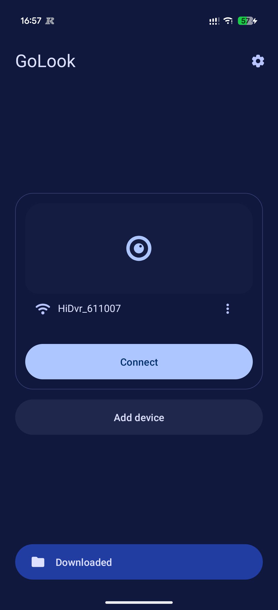
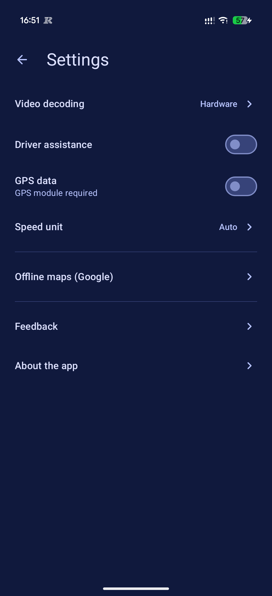
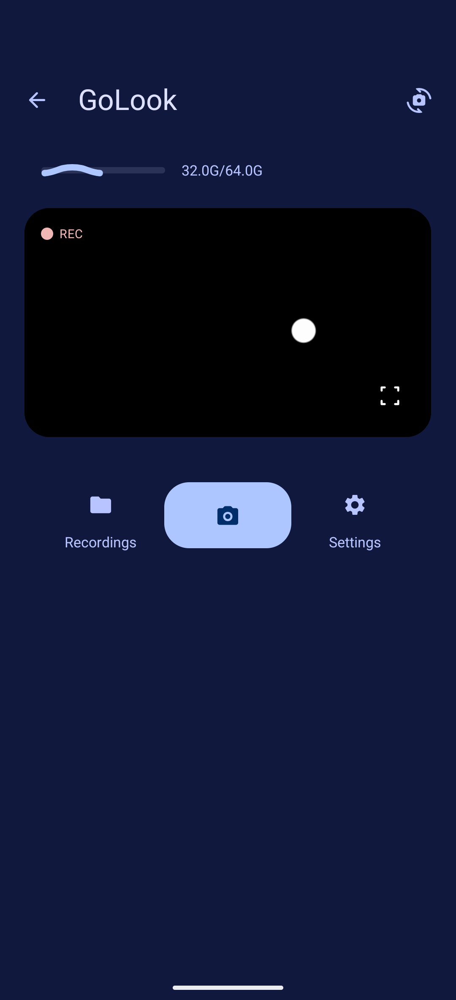
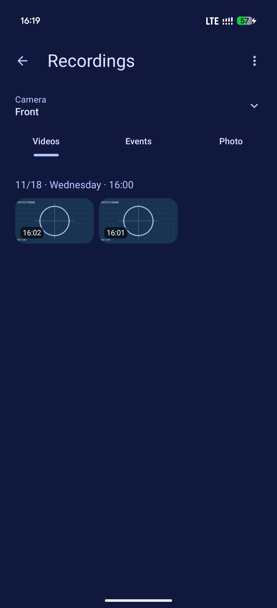
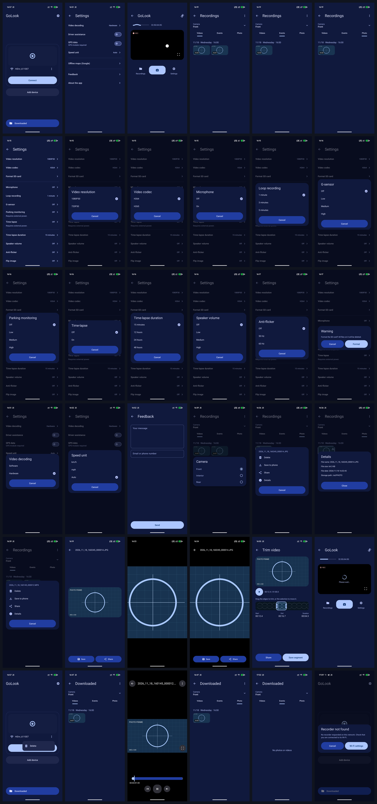

<div align="center">

# GoLook Material

[](https://github.com/bl3xand/GoLook-Meterial/releases)
[](https://github.com/bl3xand/GoLook-Meterial/stargazers)
[](https://github.com/bl3xand/GoLook-Meterial/releases/latest)
[](https://github.com/bl3xand/GoLook-Meterial/issues)

A local tool for updating a dashcam app's user interface.






</div>

## What's changed

- **Material Expressive UI** with a new icon, light and dark themes, and dynamic colors.
- **Improved translations** across all 19 language versions.
- **Layout and navigation fixes** for more consistent screens, dialogs and controls.
- **Lossless MP4 sharing** for TS recordings, with the original file preserved.
- **Production cleanup** removes developer menus, factory test screens and log-export tools.

## Screenshots



## Supported version

Support is intended for **1.5.8**. Supply the original **XAPK** with **arm64-v8a** libraries; the base APK and native split are combined automatically. Other versions are untested.

## Build

Requires Linux, **Python 3.10+**, a **JDK** with `java` and `javac` (development uses JDK 25), **LLVM** with `llvm-strip`, **Apktool 2.12.1**, Android SDK **Platform 36** and **Build Tools 37.0.0**. An internet connection is required to fetch pinned build dependencies from their upstream sources.

Run the following commands in Bash, from the directory containing `build_ui.py`.

### 1. Prepare the environment

```sh
python3 -m venv .venv
source .venv/bin/activate
python3 -m pip install -r requirements.txt

export ANDROID_SDK_ROOT=/path/to/Android/Sdk
export APKTOOL_JAR=/path/to/apktool-2.12.1.jar
export JAVA_HOME=/path/to/jdk
```

Replace the example paths with your local SDK, Apktool JAR and JDK directories. The SDK must contain `platforms/android-36` and `build-tools/37.0.0`.

Keep `llvm-strip` on `PATH`, or set `LLVM_STRIP=/path/to/llvm-strip`. The builder removes offline native debug information and verifies that every mapped segment remains unchanged. Native libraries are then compressed in the APK and extracted by Android during installation. The report records package size and debug bytes removed. The download becomes smaller; installed size also includes the extracted libraries.

### 2. Check the input

```sh
python3 build_ui.py inspect /path/to/original.xapk
```

Shows the detected base APK, ARM64 split and file checksum.

### 3. Create a signing key

If you already have a key for this build, reuse it. Otherwise create one; the command asks for a password:

```sh
"$JAVA_HOME/bin/keytool" -genkeypair -keystore ui-local.p12 \
  -storetype PKCS12 -alias ui -keyalg RSA -keysize 3072 -validity 10000
```

Keep the key and password: future updates must use the same key.

### 4. Build and sign

Read the keystore password without placing it in shell history, then build:

```bash
read -r -s -p 'Keystore password: ' UI_STORE_PASSWORD
printf '\n'
export UI_STORE_PASSWORD

python3 build_ui.py build /path/to/original.xapk \
  --output ./output/material-ui.apk \
  --keystore ./ui-local.p12 --alias ui

unset UI_STORE_PASSWORD
```

The result is a signed APK and a JSON build report in `output/`. The input is kept unchanged; existing output files are not overwritten. Downloaded dependencies and temporary build files are prepared locally and cleaned up afterwards.

To sign separately, replace `--keystore ... --alias ...` with `--unsigned`.

### 5. Verify and install

Install the APK manually, or use USB debugging with Android SDK Platform Tools installed and the computer authorized:

```sh
"$ANDROID_SDK_ROOT/build-tools/37.0.0/apksigner" verify ./output/material-ui.apk
"$ANDROID_SDK_ROOT/platform-tools/adb" install -r ./output/material-ui.apk
```

The app requires an **ARM64** device with **Android 7.0+** and **4 KiB memory pages**. This UI tool retains the input's native libraries and does not add native 16 KiB-page support. An installed app with a different signature cannot be replaced by this build. Removing an existing installation deletes its app data, so save anything you need first.

## License

[Apache License 2.0](https://github.com/bl3xand/GoLook-Meterial/blob/main/LICENSE)
